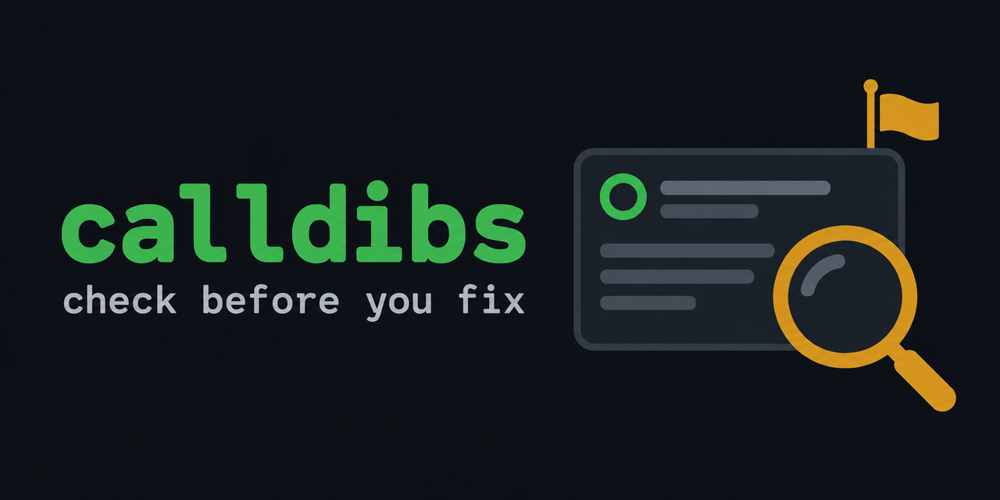

<p align="center">
  
</p>

<p align="center">
  <b>Check that nobody is already working on a GitHub issue before you start a fix.</b>
</p>

<p align="center">
  
  
  <a href="https://github.com/astral-sh/uv"></a>
  <a href="https://github.com/astral-sh/ruff"></a>
  <a href="skills/calldibs/SKILL.md"></a>
  <a href="LICENSE"></a>
</p>

---

## ✨ Why

You find a bug, you fix it, you open a PR, and then you see that someone opened the same fix two days ago. Or the project wanted you to get assigned first. Or it doesn't take AI-written code at all.

Before I pick up an issue I want to know:

- 🔍 Is there already a PR for it?
- 🙋 Did someone say they'd take it?
- 👤 Is it assigned to someone?
- 📜 What does the project ask from contributors: a CLA, a DCO sign-off, an AI policy, an issue that has to be accepted first?

`calldibs` answers all of that with one GraphQL request.

```console
$ calldibs acme/widget#412
acme/widget#412  Crash when the config file is empty
  STOP  open PR #418 by alice: fix(config): handle an empty file
  LOOK  bob said they would take it on 2026-10-20: "I'd like to work on this"
  NOTE  closed PR #405 by carol: guard empty config; it was not merged, read why before redoing it
  NOTE  CLA: CONTRIBUTING.md:31: You need to sign a Contributor License Agreement (CLA) before we can accept your PR.
  NOTE  issue gate: CONTRIBUTING.md:38: The issue must carry the `accepted` label before you open a PR.
stop: someone is already on this, or it is not open for work
```

## 📦 Install

| With | Command |
| --- | --- |
| uv | `uv tool install git+https://github.com/bercedev/calldibs` |
| pipx | `pipx install git+https://github.com/bercedev/calldibs` |
| pip | `pip install git+https://github.com/bercedev/calldibs` |
| run once, no install | `uvx --from git+https://github.com/bercedev/calldibs calldibs owner/repo#123` |

It needs Python 3.10 or newer and nothing else.

🔑 It reads a token from `GH_TOKEN` or `GITHUB_TOKEN`. If neither is set, it asks `gh auth token`. Read access to public repositories is enough.

## 🧭 Usage

```bash
calldibs owner/repo#123                    # check an issue
calldibs https://github.com/owner/repo/issues/123   # links from notifications work too
calldibs owner/repo#123 -k crash           # also flag open PRs with "crash" in the title
calldibs owner/repo#123 --ignore 456       # skip PR #456 after you checked it by hand
calldibs owner/repo                        # only print the repository's contribution rules
calldibs owner/repo#123 --json             # JSON for scripts and agents
```

🔗 The exit status is `0` when the issue is clear, `1` when there is something to stop at or look at, and `2` on errors. So you can put it in front of a push:

```bash
calldibs owner/repo#123 -k crash && git push && gh pr create
```

## 🚦 What it checks

| | Level | When |
| --- | --- | --- |
| 🛑 | **STOP** | The issue is closed, or the repository is archived |
| 🛑 | **STOP** | The issue is assigned to someone else |
| 🛑 | **STOP** | An open PR would close the issue (`Fixes #123`, or linked in the sidebar) |
| 👀 | **LOOK** | An open PR mentions the issue without closing it |
| 👀 | **LOOK** | A merged PR closes the issue, but the issue is still open |
| 👀 | **LOOK** | Someone said they'd take it, in a comment or in the issue form (`[x] I'm willing to submit a PR`) |
| 👀 | **LOOK** | A label like `wontfix`, `duplicate`, `invalid` or `blocked` |
| 👀 | **LOOK** | An open PR has one of your `-k` words in its title |
| 📝 | **NOTE** | Your own PRs for the issue |
| 📝 | **NOTE** | Closed PRs that were not merged, so you can read why before you redo them |
| 📝 | **NOTE** | PRs in other repositories (forks) that mention the issue |
| 📝 | **NOTE** | Lines about AI tools, a CLA, a DCO sign-off or an issue gate in `CONTRIBUTING.md`, the PR template, `AGENTS.md` or `AI_POLICY.md` |

## 🤖 For AI agents

Coding agents open a lot of duplicate PRs, and they rarely read `CONTRIBUTING.md` first. calldibs gives them both answers in one command.

### Install the skill

The repo ships an [agent skill](skills/calldibs/SKILL.md) that tells an agent when to run calldibs and what to do with each result. Install it with the [`skills`](https://github.com/vercel-labs/skills) CLI:

```bash
npx skills add bercedev/calldibs            # this project
npx skills add bercedev/calldibs -g         # all your projects
npx skills add bercedev/calldibs -a claude-code   # one agent only
```

It works with Claude Code, Codex, Cursor, OpenCode and the other agents the `skills` CLI supports. You can also copy `skills/calldibs` into your agent's skills folder by hand, for example `~/.claude/skills/`.

### JSON output

```json
{
  "target": "acme/widget#412",
  "title": "Crash when the config file is empty",
  "verdict": "stop",
  "summary": "someone is already on this, or it is not open for work",
  "findings": [
    {"level": "STOP", "message": "open PR #418 by alice: fix(config): handle an empty file"},
    {"level": "NOTE", "message": "CLA: CONTRIBUTING.md:31: You need to sign a Contributor License Agreement (CLA) before we can accept your PR."}
  ]
}
```

On an error it prints `{"error": "..."}` and exits with `2`.

## ⚠️ Limits

- 📜 The rule lines come from keyword matching. They point you to the right part of the file; read the file itself before you decide.
- 🗣️ Claim detection only knows English phrases like "I'd like to work on this", "can I take this" and `/assign`.
- 📄 It reads the newest 100 comments and the newest 100 linked PRs. That covers nearly every issue.
- 🤖 It does not look at CLA bots or required checks on recent PRs.

## 🛠️ Development

```bash
uv sync
uv run ruff format src tests
uv run ruff check src tests
uv run python -m unittest discover -s tests
```

The code is one module, [`src/calldibs/cli.py`](src/calldibs/cli.py), with no runtime dependencies. [`AGENTS.md`](AGENTS.md) has the notes for coding agents working on this repo.

## 📄 License

[MIT](LICENSE)
